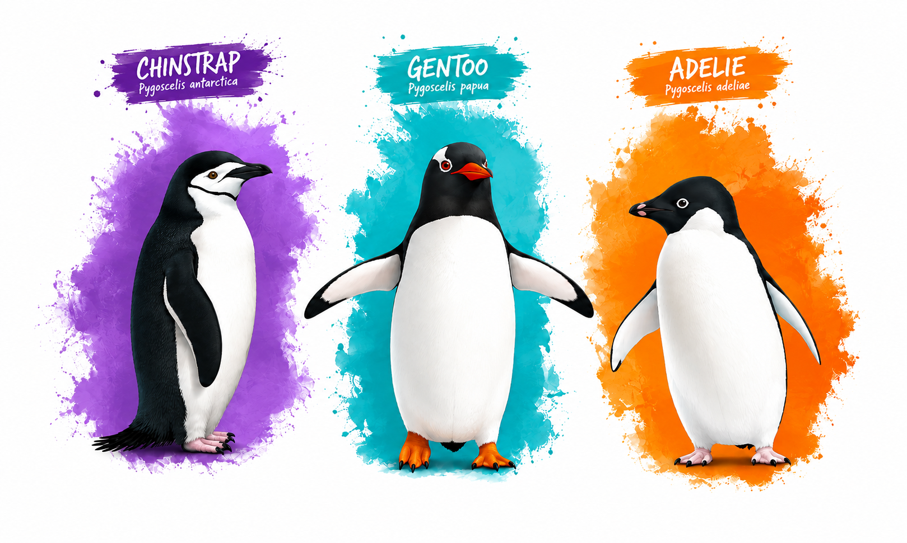

# Palmer Penguins — DataPlus

Versão enriquecida do conjunto de dados Palmer Penguins, com transformações, padronização de variáveis, imputação de valores ausentes e criação de novas características para análises estatísticas e projetos de ciência de dados.

## Sobre a base

O Palmer Penguins reúne informações sobre três espécies de pinguins do arquipélago Palmer, na Antártida. O conjunto de dados contém medidas biométricas, informações sobre reprodução e sexo, além de variáveis relacionadas à ecologia alimentar.

Este projeto parte da base original disponibilizada pelo pacote `palmerpenguins`, preservando uma cópia dos dados brutos e disponibilizando uma versão transformada e enriquecida.

## Arquivos disponíveis

| Arquivo | Descrição |
|---|---|
| `penguins_raw.xlsx` | Base original, sem as transformações realizadas neste projeto. |
| `penguins_plus.xlsx` | Versão enriquecida, com variáveis padronizadas, valores ausentes imputados e novas características. |
| `penguins_imagem.jpg` | Imagem ilustrativa do conjunto de dados. |

## Transformações realizadas

### 1. Seleção e padronização das variáveis

Foram removidas colunas de identificação e informações consideradas desnecessárias para as análises propostas. Os nomes das variáveis foram traduzidos e padronizados em português, e os valores das categorias foram adaptados para facilitar a interpretação.

### 2. Conversão de unidades

As medidas biométricas foram convertidas para unidades mais convenientes:

- Comprimento e profundidade do bico: milímetros para centímetros.
- Comprimento da nadadeira: milímetros para centímetros.
- Massa corporal: gramas para quilogramas.

### 3. Imputação de valores ausentes

Os valores ausentes foram tratados por meio dos seguintes procedimentos:

- Variáveis numéricas: mediana calculada dentro de cada espécie.
- Sexo: moda global da variável.

Esses procedimentos permitem trabalhar com uma base sem valores ausentes nas variáveis tratadas.

### 4. Engenharia de variáveis

Foi criado o índice de alongamento do bico, calculado pela razão entre o comprimento e a profundidade do bico:

\[
I_{\text{alongamento}} =
\frac{\text{comprimento do bico}}
{\text{profundidade do bico}}
\]

O índice representa a proporção entre as duas dimensões biométricas, acrescentando uma característica morfométrica derivada às variáveis originais.

A versão enriquecida também contempla variáveis relacionadas à morfologia e à ecologia alimentar, ampliando as possibilidades de exploração das características dos indivíduos.

## Considerações para análise

As variáveis originais de comprimento e profundidade do bico foram mantidas, mesmo após a criação do índice de alongamento. Essa escolha preserva as medidas biométricas individuais para análises exploratórias e diferentes abordagens estatísticas.

Entretanto, como o índice é calculado a partir dessas duas medidas, recomenda-se avaliar a redundância entre as variáveis antes de utilizá-las simultaneamente em modelos estatísticos ou preditivos. A seleção deve considerar o objetivo da análise e as características do método empregado.

## Fonte dos dados

- Pacote R [`palmerpenguins`](https://allisonhorst.github.io/palmerpenguins/).
- Fonte original: [Palmer Station Antarctica LTER](https://pallter.marine.rutgers.edu/).

Os créditos, as condições de uso e as referências da fonte original devem ser preservados na redistribuição dos dados.
